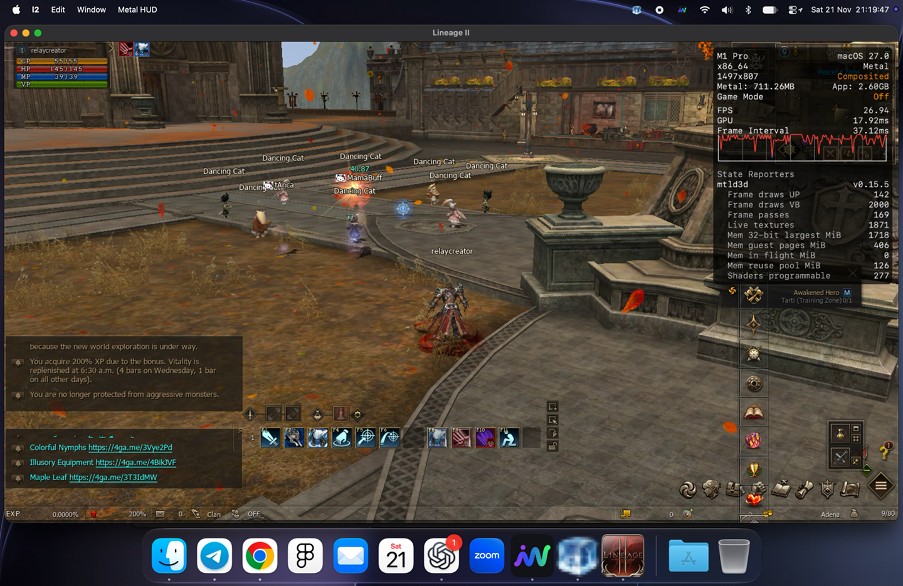
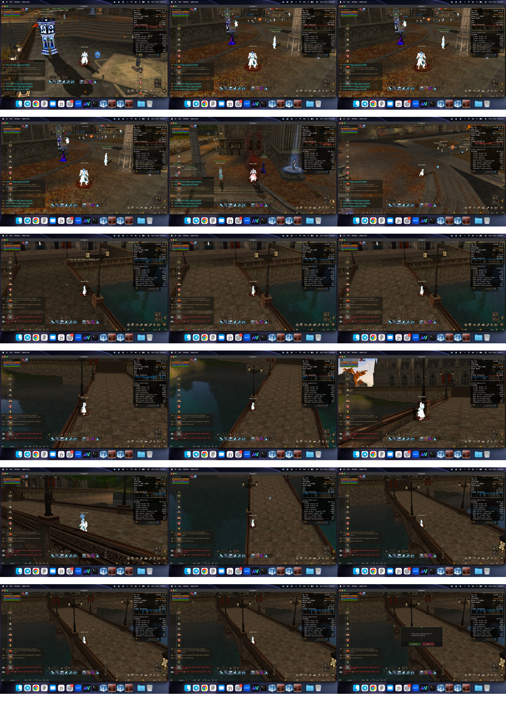
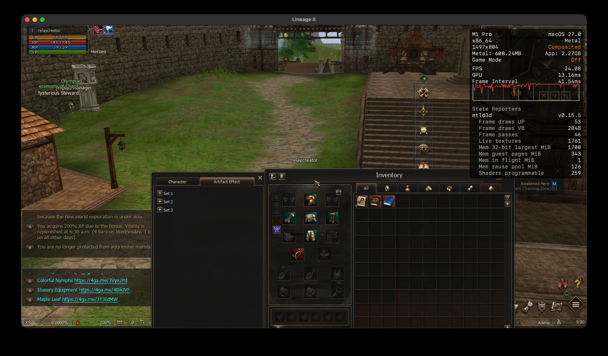
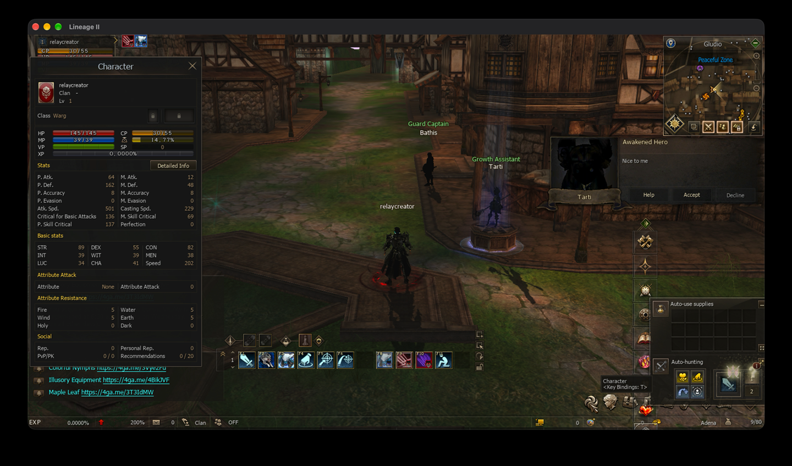
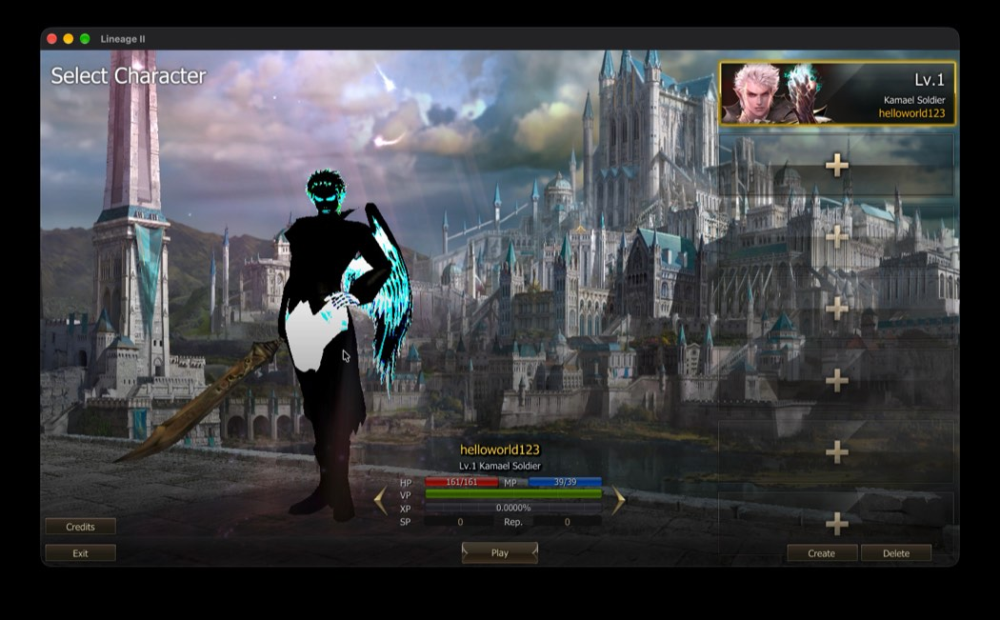
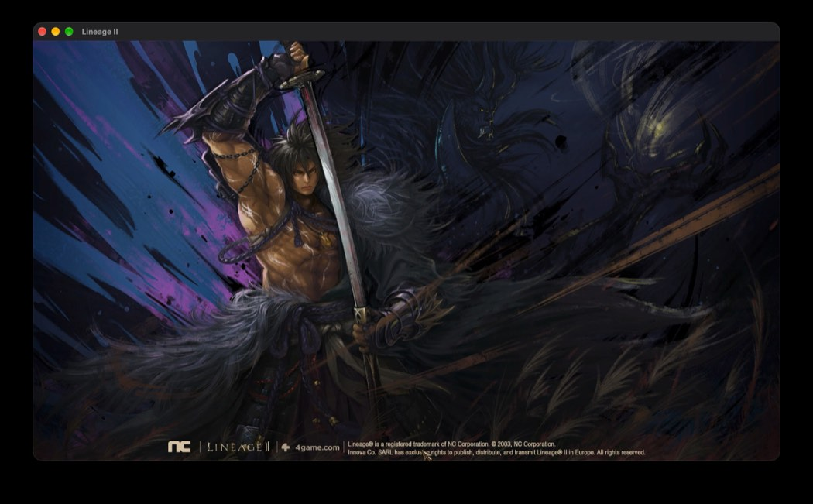
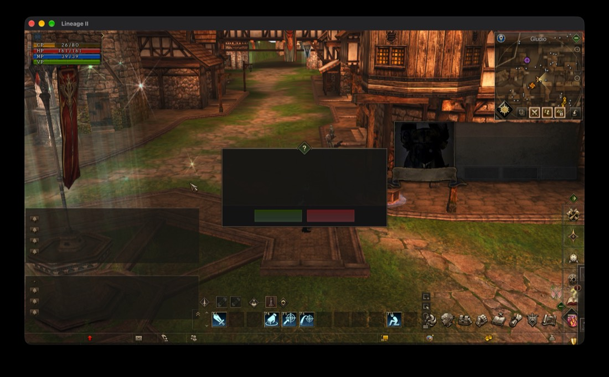

# Lineage II macOS Relay

An unofficial source alpha for running the Lineage II EU launcher and Windows
game on Apple Silicon Macs through Wine. Developed with AI assistance and local
testing. Independent of Innova and NCSoft.

## New milestone: sound and performance

**21 November 2026 — sound is back in the official client, and C4 became playable.**

Pinned **x87sidecar v1.9.1 + Metal** allowed the maintainer to restore audible
sound with responsive world interaction in the official 4game client. A separately
downloaded C4 client also worked with sound: about **66 FPS at login**, versus
earlier samples near 10, and **30–50 FPS reported in-world after increasing
quality and view distance**. These are local observations, not a controlled
6.5× speedup benchmark. **Official-client Reconnect still recurs after about
1–2 minutes.**

[Official gameplay, 10 seconds](docs/experiments/2026-11-21-x87-audio/official-gameplay-10s.mp4) ·
[C4 gameplay, 10 seconds](docs/experiments/2026-11-21-x87-audio/c4-gameplay-10s.mp4) ·
[Results, screenshots and opt-in instructions](docs/experiments/2026-11-21-x87-audio/README.md).
The clips are normal-speed and silent because their source recordings contain
no audio tracks. Audible playback was confirmed separately by the maintainer.

For an existing Metal source setup, close its launcher/game, then run
`python3 x87_audio.py` and `./dev run`. The command checks pinned downloads,
Rosetta compatibility, actual cooperative attachment, Metal and audio before
activation. `python3 x87_audio.py --disable` restores the earlier audio-disabled
mode. New source setups enable x87 audio automatically.

## Earlier video demos

**21 November 2026 — several minutes of world interaction, with Reconnect still unresolved.**

[Latest full recording — 5:52, MP4](https://github.com/deusmarsh/unnoficial-relay-l2/releases/download/world-demo-2026-11-21/lineage2-metal-gameplay-2026-11-21-720p.mp4).
Two reconnects successfully return to the world. Movement is visible more than two
minutes after the first return; the second interval lasts about 2:37 from return
to the next dialog. The complete recording preserves the remaining stalls and
Reconnects. It is normal-speed, 720p and silent; it is not six uninterrupted minutes
of stable play. [Setup and evidence](docs/experiments/2026-11-21-metal-default/README.md).

**20 November 2026 — earlier first usable world session.**

- [Walking, camera movement and windows — 1:35, MP4](https://github.com/deusmarsh/unnoficial-relay-l2/releases/download/world-demo-2026-11-20/lineage2-metal-world-walk-2026-11-20.mp4): continuous gameplay excerpt.
- [Full session, including the remaining Reconnect — 2:21, MP4](https://github.com/deusmarsh/unnoficial-relay-l2/releases/download/world-demo-2026-11-20/lineage2-metal-full-session-2026-11-20.mp4).

720p exports at normal speed, without audio. The short excerpt ends before the
Reconnect; the full recording preserves it. This earlier recording came from the manually prepared test copy. Material defects and disconnects remain.
[Experiment details](docs/experiments/2026-11-20-audio-output/README.md).

**Earlier milestone:** [17 November alpha demo (.mov)](https://github.com/deusmarsh/unnoficial-relay-l2/releases/download/alpha-demo/demo.mov), retained as project history.

## Quick start

On an Apple Silicon Mac with macOS 15.4 or later, clone or download this repository.
Allow several GB for setup and roughly 41 GB for the game. Setup prompts for
Apple's Command Line Tools and Rosetta if needed.

1. Open **Develop.command** and choose **Set up / resume**, or run `./dev setup`.
2. Setup builds the corrected Metal renderer and enables x87 audio.
   Follow the setup wizard and complete the official publisher's installer.
3. Choose **Run changed sources** or run `./dev run`. Sign in and download the
   game in the official launcher.

Existing installations keep their configured runtime. To move to Metal, close the
launcher/game and run `./dev setup`; the new default `.local-metal-audio-v2` directory
keeps the old prefix and downloaded game intact. If that directory already contains
an older recipe, choose a new `--work-dir`. Sign-in and game installation in the
new prefix are still manual.

See [Installation](INSTALL.md) for setup details and [Contributing](CONTRIBUTING.md)
for editing, rebuilding, and submitting changes.

## Alpha status

| Scenario | Status |
| --- | --- |
| Launcher startup, login, and game download | Worked on the maintainer's Mac |
| Game startup, server selection, and character creation | Worked on the maintainer's Mac |
| Entering the game world | Confirmed on the maintainer’s Mac. Gludio loaded after character selection. |
| Short movement/UI trial | Confirmed in Metal test sessions with audio output disabled; latest recording includes two world returns lasting over two minutes each. Reconnect remains. [Evidence](docs/experiments/2026-11-20-audio-output/README.md). |
| Sustained gameplay | Still to be verified |
| Fresh setup through game launch on another Mac | Still to be verified |
| Native game UI text | Restored locally with physical Arial/Tahoma files; setup and launcher startup now prepare missing files. |
| Rendering, performance and sound | Metal + x87sidecar restored audible sound with responsive interaction in the local official-client trial; C4 also became playable. Reconnect remains. [New results](docs/experiments/2026-11-21-x87-audio/README.md). No controlled average-FPS speedup is claimed. |

**Character-material correction:** the observed white/cyan corruption in the
local official-client Metal trial was fixed by a downstream mtld3d shader patch.
[Before/after screenshots and source-build instructions](docs/experiments/2026-11-21-material-fix/README.md).
For an existing Metal source setup with the pinned Rust tools, close the
launcher/game, run `python3 material_fix.py`, then `./dev run`. This builds into a
separate runtime copy and preserves the current audio/x87 selection. New source setups apply the shader patch automatically. Reconnect remains unresolved.

Status updated 21 November 2026. These are results from the maintainer’s existing
installation, not a fresh-install or sustained-play guarantee. The GitHub checks
cover source tests and the macOS interface build.
See [experiment notes](docs/experiments.md) for the gameplay baseline.

### Current local evidence

*18 November: native UI text is readable after the two-font repair. Dark character
and NPC models remain. This frame does not establish sustained gameplay.*

### Earlier world-entry run before font repair

| Character selection | Loading the world |
| --- | --- |
|  |  |

*Gludio during a local alpha run. The city and HUD loaded, and a blank dialog remained on screen. Screenshot includes artwork from the official game.*

## How it works

The official launcher and game run through Wine. The default launcher opens its own
Wine window with native window controls, using the tested Chromium `in-process-gpu`
configuration. It avoids capturing, encoding and displaying a stream of screenshots.
Account login, downloads and Play remain in the official launcher. New source setups render the game
in its own window through Direct3D 9 → mtld3d → Metal, with the corrected shaders and x87 audio enabled.
If the game is silent, check the sound setting inside Lineage II. Older configured installations retain their previous renderer and audio settings.

After closing the official launcher, `./dev run --relay` selects the previous screenshot
display as a fallback. For a packaged app, use `open -a "Lineage II Launcher" --args --relay`.
Close the launcher before switching modes and let active downloads finish. Closing
the official launcher may also stop the game. Reopening the same mode preserves the
running launcher and its downloads.

Only one launcher may use the local debug port 8088; do not expose it to the network.
Direct mode uses it briefly for startup recovery, without ongoing screenshot capture.

## Areas for contribution

- Reproduce and improve game stuttering, model colors and reconnect/loading failures.
- Verify automated font preparation on fresh installations and other Macs.
- Verify fresh setup and game-world entry on other Macs.
- Improve launcher display, input and setup reliability.
- Investigate alternative rendering paths with before/after evidence.

Record useful results in [Experiments](docs/experiments.md). See [Technical notes](TECHNICAL.md)
for dependencies and build details. Start with [AGENTS.md](AGENTS.md) when working
with an AI assistant.

## License and local data

Original code and icons: MIT. Wine-derived patches: LGPL-2.1-or-later. Dependencies
retain their own terms; see [third-party notices](THIRD_PARTY_NOTICES.md).
Game files, publisher binaries, accounts and runtime installations are not included.
Local configurations, downloaded dependencies and generated apps stay outside Git.

Custom icon generation is deferred and disabled in source setup/run and CI.
The code is retained; see [Deferred icons](docs/deferred-icons.md).
