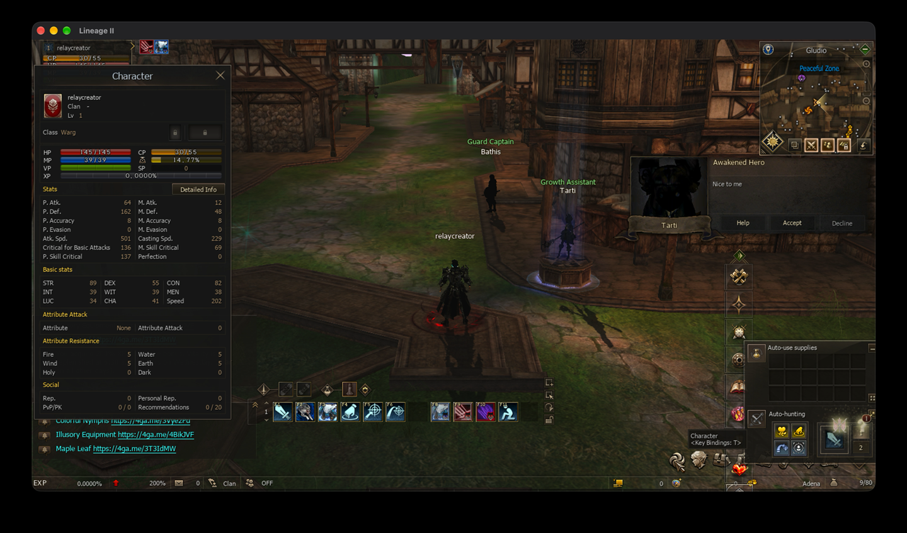
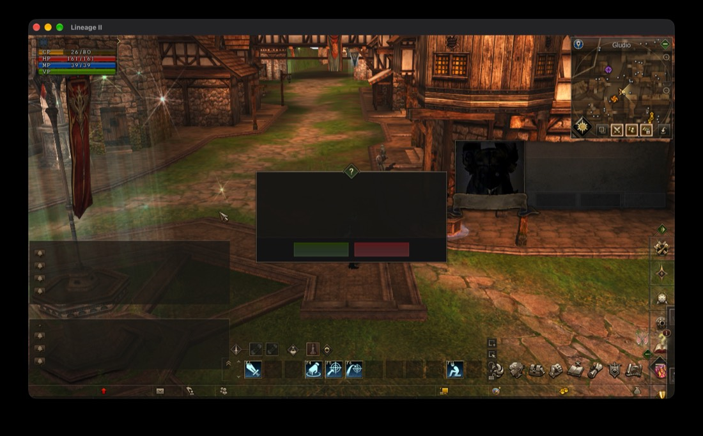
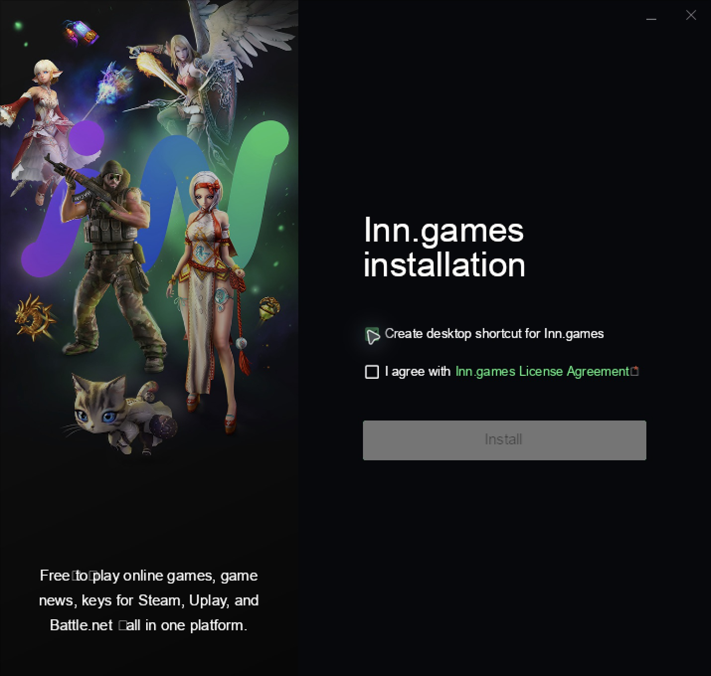

# Status and experiments

## Current status — 19 November 2026

On the maintainer’s Apple M1 Pro / 16 GB / macOS 27.0 installation, the client
entered Gludio on 18 November. Missing native UI text was subsequently restored
by supplying physical Arial/Tahoma files, as described below. Source setup and
launcher startup now prepare those files; direct launcher display is the default.
Updater HTTPS trust is prepared with pinned ISRG Root X1, as detailed below.
Severe game stalls, incorrect model colors and a later Reconnect/loading loop
remain unresolved. Movement and sustained gameplay are not established, and the
combined automation has not been exercised through a fresh account/game setup.

*Frame at 120 seconds of the reviewed 201-second recording. Captions and statistics
are readable; models remain dark. This is earlier local evidence, not a new game
trial of the combined source changes.*

## Historical baseline — 17 November 2026

The maintainer reports: the official launcher starts, the game downloads and starts,
server selection works, and a character can be created. Entry into the game world
and sustained gameplay have not been established. Stuttering and incorrect textures
or model colors remain investigation areas; earlier tests also observed missing text
and a blank dialog. Recheck whether those older issues persist in your scenario.

The tested rendering path is Direct3D 9 → WineD3D → OpenGL. DXVK/Metal is not a
verified replacement. Launcher Chromium frame rate does not measure game frame rate.

Existing private diagnostic samples are not bundled or treated as published evidence.
This page records the baseline, not a claim that clean installation works on all Macs.

## World entry — 18 November 2026

The maintainer created and selected a character and entered Gludio using the
existing Wine 10 / WineD3D / OpenGL installation on Apple M1 Pro, 16 GB, macOS 27.0.
The city and HUD appeared by about 2:22 of the roughly six-minute recording and
remained visible through its end. A blank dialog, stalls and rendering defects
still blocked normal use. This completed [issue #5](https://github.com/deusmarsh/unnoficial-relay-l2/issues/5#issuecomment-6986181060)
for the world-entry milestone; movement and sustained gameplay were not verified.

*The earlier blank dialog is preserved as historical before-repair evidence.*

## Missing native UI text — 18 November 2026

Result: missing native UI text restored in the maintainer's existing installation.
The maintainer signed in and entered Gludio; the reviewed recording shows readable
server selection, character statistics, chat, quest text, Teleport and modal
Reconnect/Exit captions. This resolves the text symptom tracked in issue #3.

### Environment and baseline

Apple M1 Pro MacBook Pro, 16 GB RAM; macOS 27.0 (26A428). Existing standalone
preview runtime, Wine 10-based patched environment, Direct3D 9 → WineD3D → OpenGL.
This was a local repair of that installed runtime, not a clean build from this PR.
The PR is based on source commit `9061f53`; no graphics backend or game settings
were changed for the two-file font trial. The original installed app's precise
source commit was not independently established.

Most button captions and dialog text were invisible, although buttons responded.
Numbers, the unique player nickname at character selection, and some labels
remained visible. Therefore surviving text could not all be explained as static
pictures, nor did its presence prove that the failing native UI path worked.

### Investigation

1. Earlier 32-bit GDI probes created named Arial/Tahoma fonts and nonempty Latin
   and Cyrillic glyph bitmaps. That verified name lookup, not the game's direct
   file access. A later Arial probe still returned a 108-byte glyph bitmap while
   opening the required font file failed.
2. Read-only inspection of one blank native NWindow button found a nonempty `OK`
   caption, visibility enabled and alpha 255. The text was assigned and not
   transparent. Investigation moved from a possible GFx issue to native text.
3. The native font manager had default `FONTID = -1` and zero registered names.
   Its backend retained 57 font requests using
   `C:\windows\Fonts\tahoma.ttf`.
4. Inspection of the built-in initialization path found Arial size 12 loaded from
   the Windows directory plus `\Fonts\Arial.ttf`. The text measurement and draw
   fallback paths select the manager's default font when the input font is
   missing/invalid. Falling back cannot help when that default is also invalid;
   missing glyph textures or zero glyph dimensions skip drawing.
5. Direct file opens of both Windows font paths failed with error 2 (file not
   found), despite working GDI name lookup. The initialization code identifies
   the built-in Arial fallback; it does not prove that this exact registration
   was attempted in every affected session.

### Exact change and observed result

Copied the Mac's existing `/System/Library/Fonts/Supplemental/Arial.ttf` and
`Tahoma.ttf` into this prefix's Windows Fonts directory as `Arial.ttf` and
`tahoma.ttf`, preserving other files. Direct Windows opens then succeeded.
Launched a new client, with no game binary patch, renderer replacement or font
registry edit. The manager then had 57 registered fonts and default ID 1 under
`GAMEDEFAULT`. The maintainer immediately confirmed restored captions.

The subsequent 201-second screen recording also verified text in the game world,
including the previously unreadable dialogs. This establishes a successful local
before/after trial. Both fonts were installed together; their individual
necessity was not isolated. We have not traced each surviving label's renderer.

The source fix now performs the same missing-file preparation after Wine prefix
initialization in both setup paths and before normal launcher startup, so existing
configured prefixes also receive it. Case-insensitive existing filenames are
preserved. Missing macOS source fonts produce a diagnostic rather than a download.
Fonts themselves and private diagnostic logs/recordings are not published.

### Validation and limits

Portable regression checks cover direct destination paths, repeat runs, preserving
existing fonts/casing, missing source diagnostics and refusing a Fonts directory
that redirects writes outside the prefix. Launcher handoff checks exercise the
startup integration. See the PR for the actual check results.

The manual trial validates the two-file repair; the new automated setup paths
have not been followed through a fresh installation and account sign-in. Character
and NPC models can still appear black (issue #2). A later Reconnect dialog and
loading loop remain unresolved: the recording does not establish that opening
Teleport caused the disconnect. Restored text makes that failure readable; it
does not establish stable gameplay or a connection fix.

## Updater HTTPS trust — 19 November 2026

The pinned official installer and the launcher downloaded during a fresh install
both contained a CA file with GlobalSign certificates but no ISRG Root X1.
The updater explicitly uses its own `rootcert.ca`, with default CA loading off.
A new Wine prefix and registry reproduced certificate verification errors during
installation; the publisher's HTTP fallback allowed installation to finish.
This does not establish the behavior on native Windows.

On an Apple M1 Pro MacBook Pro, macOS 27.0 (26A428), using the existing patched
Wine 10 executable with that fresh prefix, the real `4updater.exe` was then run
against the installed launcher distribution over an explicitly HTTPS URL:

| CA configuration | Exit code | Certificate-error log lines | HTTP request lines |
| --- | ---: | ---: | ---: |
| Original publisher file | 70 | 20 | 0 |
| Original file plus fingerprint-verified ISRG Root X1 | 0 | 0 | 0 |
| PR helper extracting the installed launcher's updater resource and adding X1 | 0 | 0 | 0 |

Counts are matching lines in each network log, not distinct failures. Successful
runs reported the distribution up to date. No game or account session was needed.
Original binaries and SSL verification configuration were unchanged. A separate
probe through the same OpenSSL DLLs also verified the hostname and received HTTP
200. Private raw logs, prefixes and publisher binaries are not published.

The code prepares the updater before installer startup (shared by source and
packaged setup), and before each normal launcher startup. Publisher resource
extraction is lazy: an existing `forgameUpdater/4updater.exe` skips extraction.
Preparation extracts the same local ZIP resource first when needed, then appends
only the pinned root certificate. Existing updater executables are preserved;
repeat runs do not duplicate the certificate. Replaced CA files are repaired at
the next Mac launcher startup. Changes to the publisher ZIP layout require review.

Validation: fresh verified installer preparation through the PR code; real updater
check through the PR helper in the installed fresh prefix; offline regression
suite. A complete packaged app rebuild and a second full interactive install
using the final PR code were not performed. This fixes updater trust, with no
claim about black models, stuttering, disconnects or gameplay stability.

First screen captured before the maintainer accepted the publisher agreement.
This screenshot documents the installation context, not the HTTPS result; the
measured results are in the table above.

## Add an experiment

For each useful experiment record:

- Date, source commit, Mac/chip, macOS and runtime/dependency versions.
- Hypothesis and exact source/config change (without private paths or account data).
- Reproduction: scene, settings, duration and measurement method.
- Baseline and changed result; repeatability and possible confounding factors.
- Launcher versus game effects, regressions and checks not performed.
- Conclusion: verified improvement, no observed effect, regression or inconclusive.

Keep unsuccessful experiments when they help avoid repeating work. Do not infer
texture correctness or gameplay compatibility from startup alone.

## Direct launcher display — 18 November 2026

Environment: Apple M1 Pro, 16 GB, macOS 27.0, configured Sikarugir Wine 10
with the existing guarded-mutex and per-application background patches. These
interactive tests preceded this PR; its automated and packaged checks are recorded
in the pull request. No private logs, account data or publisher files are included.

Baseline: the native launcher displayed repeated Chromium screenshots and forwarded
input through CDP. The maintainer reported substantial launcher lag.

Change: show the official Wine window, set only `Launcher.exe`'s
`LineageBackgroundApp` to `N`, and use `disable-gpu`, `disable-gpu-compositing`,
`disable-accelerated-video-decode`, `force-device-scale-factor 1`, `in-process-gpu`.
A stuck startup splash recovered after one reload once the official bridge was
registered. Game updates completed and Play launched the client. A separate local
updater certificate repair was also needed during diagnosis; it is not included in
this performance change and is not attributed to direct display.

Result: the maintainer reported a large improvement in launcher responsiveness;
maximize/restore controls worked normally. This is qualitative same-Mac feedback,
not an instrumented before/after FPS measurement or a clean-install guarantee.
The PR makes this display the default and retains `--relay` as an explicit fallback.

Game boundary at the time of the direct-display trial: the client reached Gludio
but retained severe stalls, damaged model rendering, missing in-game text and an
unreadable dialog. The later font repair above restored the text and dialog captions;
it did not resolve stalls, model colors or the subsequent reconnect failure. Working Vulkan support
alongside OpenGL did not remove those issues. An isolated DXVK/MoltenVK run showed
about 0.4 FPS on the intro, while a simple D3D9 triangle/font test reached about
120 FPS. That synthetic test does not establish game compatibility. No Vulkan
runtime, DXVK deployment or game rendering change is included here. Further game
performance investigation was deferred.
