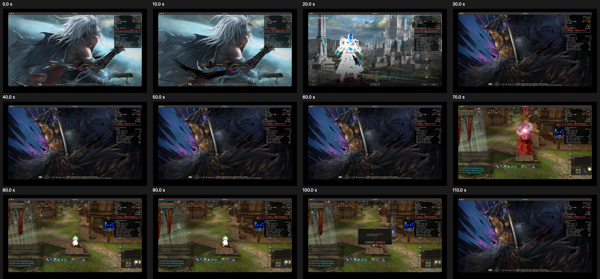
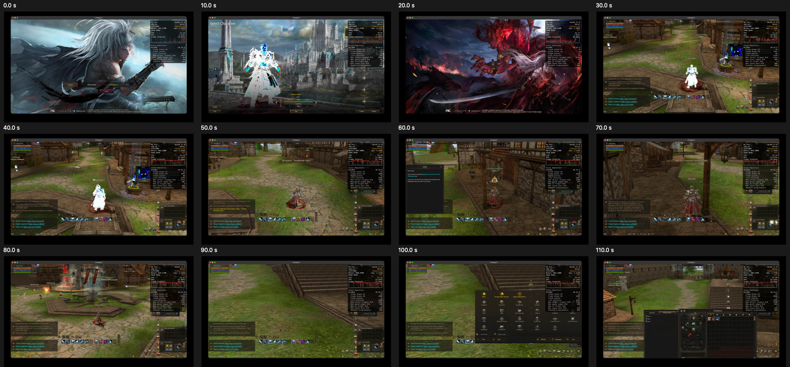
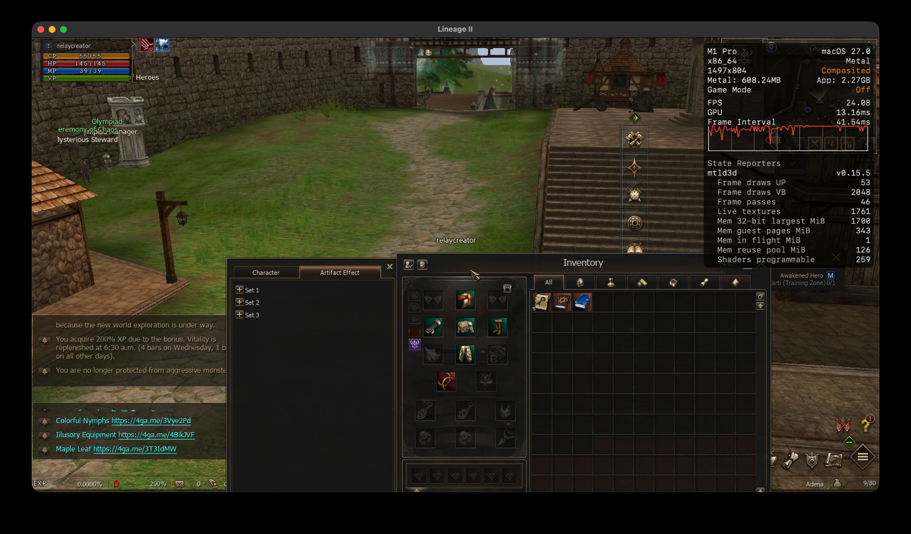
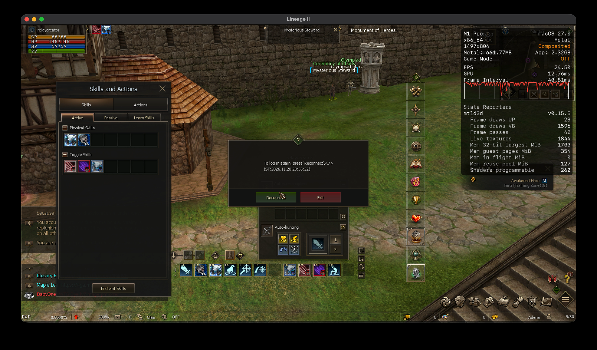

# First usable world session with audio output disabled

20 November 2026. **The maintainer could walk in Gludio, move the camera, open
windows and drag them.** A screen recording confirms changing player positions,
camera views and UI panels for roughly 95 seconds before another Reconnect.
This is a substantial local responsiveness improvement, not stable gameplay yet.

## Environment and comparison

Apple M1 Pro, 16 GB, macOS 27.0 (26A428), windowed game at 1497 x 804.
The experiment used a separate clone of the existing installation and the official
Innova/4game launcher. This was not a clean setup from the repository.

The graphics path was **D3D9 through mtld3d v0.15.5 to Metal**, using the x86-64
[Highball Wine 11.0 engine](https://github.com/gauthierpiarrette/highball-engine/releases/tag/engine-wine-11.0-20261114T185735Z-fiber-mirror-switch),
based on CrossOver 26.3.0, under Rosetta. The isolated runtime also included a
locally rebuilt ntoskrnl with this project's guarded-mutex acquire/release patches
from matching CrossOver sources. mtld3d used `shader.asyncCompile=false` and
`color.hdr.enable=false`. Upstream renderer: [athei/mtld3d](https://github.com/athei/mtld3d).
These components are experiment provenance, not new project dependencies or a
supported installer path. The launcher switches, game files and rendering setup
were retained for the audio comparison.

Baseline with audio output available: selection/creation could animate, but world
entry and subsequent loading were accompanied by severe pauses and delayed UI
sounds. A process measurement after the failed world-entry recording found one
thread using 9.940 CPU seconds over 9.969 elapsed seconds (99.71% of one core), with
zero disk read/write bytes and zero pageins during the same interval. This does
not exclude earlier disk/network waits.

Wine/macOS thread identifier mapping associated that thread with the sound path.
A separate five-second targeted context capture returned 111 valid instruction
addresses: 79 in native `wrap_oal.dll`, 32 at the Wine system-call stub for
`NtWaitForAlertByThreadId`. Exact internal OpenAL functions were not identified.
The mapping used Wine's pthread identifier and a consistently observed offset to
macOS's thread handle. Sampling was performed after the baseline recording, not
throughout gameplay; it is a diagnostic lead, not an end-to-end profile.



*Original contact sheet from the baseline recording. Timestamps are seconds within
that recording. Later frozen HUD numbers must not be read as continuous FPS.*

## Exact audio change

Restarted only the isolated test environment and added this DLL override to the
**official launcher's environment**, inherited by the game:

```text
winecoreaudio.drv=d
```

This entry was appended to the existing `WINEDLLOVERRIDES` value; existing overrides
were retained. No system audio setting or permanent registry setting was changed.
A Windows audio-endpoint probe in the same prefix/runtime reported:

| Launch environment | Active playback endpoints | Probe result |
| --- | ---: | --- |
| Control | 1 | Success |
| Audio driver disabled | 0 | Success |

The new official launcher process was checked for the correct isolated prefix and
the audio override. No game binaries, OpenAL DLLs, calendar clock or elapsed-counter
origins were changed for this comparison. This is absence of a playback device,
not a guarantee that sound code is skipped: the game still loaded
`DefOpenAL32.dll` and `wrap_oal.dll`.

## Observed result

The reviewed 141.42-second recording shows the world by second 30. Through second
125, the character changes position, camera viewpoints change and different UI
panels open. The maintainer reports that moving, dragging windows and camera
control worked with vastly reduced lag.



*Original contact sheet from the audio-disabled recording. Scenes and timing are
not matched frame-for-frame to the baseline; this is a qualitative comparison.*



HUD snapshots in the world show 14.42 FPS at second 30, 18.28 at 50, 25.51 at 60,
18.87 at 80, 29.39 at 100, 24.08 at 110, 23.03 at 120 and 24.12 at 125. These are
selected HUD readings, not average FPS, percentile frame times or a controlled
speedup ratio. The principal improvement is usable input and advancing world
frames, rather than long apparent hangs. See [measurement summary](measurements.json).

At second 130, Reconnect is visible with `ST:2026.11.20 20:55:22`; the last frames
are black. Correct calendar text therefore does not prevent this disconnect.
Earlier 1970 dates numerically corresponded to system uptime, but the relationship
between that display issue and connection handling remains unproven. This
successful session did not use the experimental timer changes.



## Limits and next checks

- One positive intervention run; no return-to-audio reversal or longer repetition
  yet. Cache warming, timing and server state remain possible confounders.
- Reconnect is unresolved; sustained gameplay and a clean-install result remain
  unverified. Incorrect white/blue character materials persist.
- Removing playback endpoints implicates the audio/output path, but does not
  establish the exact defect in Wine, the native OpenAL wrapper or the client.
- A different OpenAL implementation has not been tested. No audio library is
  replaced or distributed by this change.
- Report and evidence only: normal setup/runtime selection is unchanged. The
  source repository does not automatically reproduce this manually prepared
  Metal runtime. A future opt-in integration needs pinned dependencies and
  repeatable manual validation.

The original recordings, complete PNG frames and private diagnostic captures are
retained locally. Published PNGs here are unmodified extracted frames/contact
sheets. Account configuration, raw logs, prefixes and publisher/runtime binaries
are excluded.
