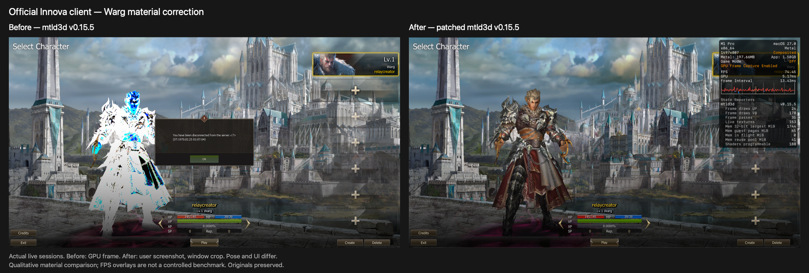

# Corrected white/cyan character materials in the official client

21 November 2026, Apple M1 Pro / 16 GB / macOS 27.0. The official Innova/4game
client displayed white/cyan faces, armor and clothing through mtld3d 0.15.5.
A downstream shader-emitter patch restored the observed character materials.
The maintainer confirmed the full Warg character and subsequently switched
through the character-creation models without the original corruption.



*Actual official-client sessions, same character. Before: original GPU frame;
after: user screenshot cropped to the game window. Poses and UI differ; before
includes a disconnect dialog and after includes the Metal HUD. This is a
qualitative material comparison, not a controlled FPS benchmark. The composite's
English captions describe its provenance; it is not a simulated rendering.*

Originals: [before PNG](before.png) · [after PNG](after.png).
Both source images are retained unchanged alongside the comparison.

## What was wrong

The captured body texture already contained normal colors. In the vertex shader,
unused lights could produce infinite reciprocal attenuation. Ordinary Metal
multiplication propagated `0 * infinity` into NaN, contaminating vertex colors.
The replayed affected draw had invalid RGB on **4,469 of 4,469 vertices** before
the fix and **0** afterward. This is a captured-draw check, not a claim about
every material in the game.

[The downstream patch](../../../patches/mtld3d-zero-multiply.patch) changes the
mtld3d-core DXSO emitter, reused by native shader compilation. MUL and MAD mask
an operand to zero before multiplication when the other operand is zero, in
both operand orders. MAD retains its fused operation and addend. Helpers are
emitted only when the shader uses those instructions, for vertex and pixel
shaders. DOT and other instructions are unchanged.

The native `mtld3d.so` is rebuilt; Windows PE components, publisher binaries and
game resources are unchanged. The emitter's existing source fingerprint makes
retained DXSO regenerate MSL; no manual shader-cache deletion was needed in the
accepted local trial.

## Build and activate in a source installation

This is an explicit opt-in for an existing Metal source setup, independent of
the x87/audio opt-in. Close that installation's launcher and game first.
Apple Silicon, Command Line Tools and the pinned Rust tools are required:

```sh
rustup toolchain install 1.99.0 --profile minimal --component llvm-tools-preview
rustup target add x86_64-apple-darwin --toolchain 1.99.0
python3 material_fix.py
./dev run
```

Rustup verifies its toolchain downloads. The helper downloads and SHA-256-checks
the pinned mtld3d v0.15.5 source archive, applies the published patch, runs the
locked core/types and Unix test suites, builds the native x86-64 production
library and runs the upstream production-assertion gate. It checks exported
symbols against the original native library, creates a separate runtime copy,
and tests a real 32-bit Metal device/presentation before updating the backed-up
local configuration. The game prefix, graphics settings and current x87/audio
selection are preserved. Local validation artifacts stay in the build directory.

For an already verified cached source archive, use `--archive PATH`. Isolated
Rust installations can be selected with `--cargo-home PATH --rustup-home PATH`.
The Makefile's nightly variable is pinned to `nightly-2026-10-11`; the selected
native build and unit-test targets use stable 1.99.0, and do not build Windows PE.

To undo activation, close the launcher/game and run:

```sh
python3 material_fix.py --disable
./dev run
```

The original runtime remains intact. The patched runtime is retained for review.
If rebuilding, use a new `--work-dir` rather than deleting a previous runtime.
New setup retains the stock renderer until this command is run. This does not
change the legacy standalone/DMG builder or silently migrate another installation.

## Validation and scope

The original accepted local patch passed **2,254 core/types tests**, **849 Unix
tests** (two ignored), formatting, native clippy and source audits. A real Metal
numeric check passed **24/24 lanes**, including zero with Inf/NaN in both orders,
negative zero, finite arithmetic and MAD addends. The captured vertex-shader replay
removed the invalid colors, followed by the maintainer's official-client screenshot
and a 48-second recording of multiple character-creation models.

[Earlier local validation summary](local-validation.json) and
[publication build/activation checks](build-validation.json) separate those
observations. No game shaders, GPU trace, account information, raw logs or runtime
binaries are distributed. The source patch includes its emitter regression tests.

The accepted defect is the observed white/cyan character-material corruption on
the tested Metal path. This does not establish complete D3D9 arithmetic conformance,
correctness of every texture/NPC, or a performance gain. Historical OpenGL defects
are a different renderer. Reconnect remains unresolved in
[#9](https://github.com/deusmarsh/unnoficial-relay-l2/issues/9).

Upstream mtld3d: [v0.15.5](https://github.com/athei/mtld3d/tree/v0.15.5),
Copyright (c) 2026 Alexander Theissen, zlib license. This is a plainly marked
downstream alteration; the original [license notice](../../../licenses/MTLD3D-LICENSE)
is retained. The game artwork remains the property of its respective owners.
