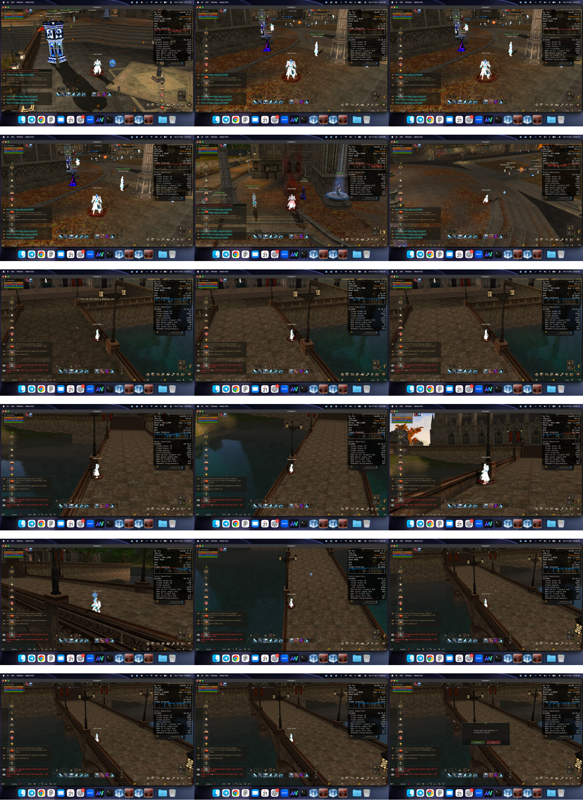
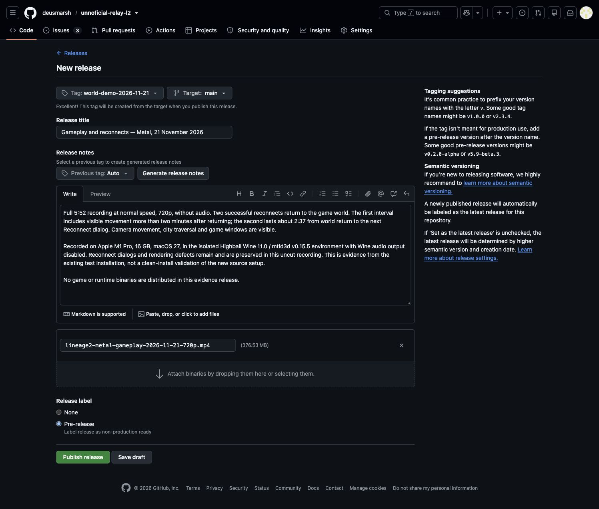

# Reproducible source setup: Metal with audio output disabled

21 November 2026. New source setup uses the runtime combination behind the local
responsiveness improvement. This integrates the configuration; it does not resolve
Reconnects or prove sustained gameplay on a fresh installation.

## Install and run

On Apple Silicon with macOS 15.4+, developer tools and Rosetta:

```sh
./dev setup
./dev run
```

Setup uses a new `.local-metal-v1` work directory. It downloads and verifies the
Highball Wine 11.0 x86-64 engine, mtld3d v0.15.5, CrossOver 26.3.0 source, and the
existing pinned support/build dependencies. It rebuilds the guarded-mutex module
from those sources using the existing synchronization patches. No experimental
timer or calendar changes are included. Upstream notices stay with the downloads;
mtld3d's zlib notice is also in the source archive.

After wineboot, both 32-bit and 64-bit native d3d9 DLLs and mtld3d prefix markers
are installed. Only L2.exe and L2.bin get the native/builtin d3d9 override. The
official launcher passes the following environment to the game:

```text
WINEDLLOVERRIDES=winemenubuilder.exe=d;winedbg.exe=d;winecoreaudio.drv=d
MTLD3D_CONFIG=color.hdr.enable=false;shader.asyncCompile=false
```

The downloaded engine's library/framework paths are supplied from the generated
configuration. These are not maintainer-specific paths. Inherited Wine/Metal/Vulkan
experiments are removed. The Mac's sound settings are unchanged; Wine playback
is intentionally unavailable in this profile. The Metal HUD is not enabled by default.

Setup checks the patched mutex, the Microsoft .NET runtime, a real 32-bit Metal
D3D9 device and zero active playback endpoints before offering activation. It
still requires the publisher's installer, terms review, sign-in and game download.

Existing configurations retain their old renderer and audio behavior on `./dev run`.
For migration close the launcher/game, then use the new default setup directory or
another unused `--work-dir`. Setup refuses to reuse an older prefix as Metal and
backs up the active configuration before explicit activation. It does not import
accounts or game files. The legacy standalone/DMG builder has not been converted;
it rejects a Metal prepared directory. Use source setup for this profile.

## Latest gameplay evidence

The latest recording is from 21 November, 12:00–12:06 CET. It contains two
successful reconnects followed by movement, camera turns and game windows.

| Source video time | Observed event |
| --- | --- |
| 0:00 | Previous Reconnect dialog already visible |
| 0:12 | World visible after first retry |
| 2:25 | Character visibly moving, more than two minutes after return |
| 2:30–2:43 | Similar stationary sampled views; HUD changes continue |
| 2:45 | Next Reconnect visible |
| 3:08 | World visible after second retry |
| Later second interval | Movement by the water, camera turns, Skills and Actions window |
| 5:44 / 5:45 | Dialog absent / present, about 2:37 after the second return |

The exact first failed movement command is unknown. The 5:52 total includes
loading, stationary intervals and dialogs; it is not uninterrupted stable gameplay.
White/blue material defects remain. The scene and input are not matched to the
20 November baseline, so this is no controlled speedup/FPS measurement.



*Original contact sheet retained from the recording review. Time labels refer to
seconds in the full recording. This evidence comes from the earlier test prefix,
not the new source-created prefix.*

[Published full 5:52 MP4](https://github.com/deusmarsh/unnoficial-relay-l2/releases/download/world-demo-2026-11-21/lineage2-metal-gameplay-2026-11-21-720p.mp4).
The [video release](https://github.com/deusmarsh/unnoficial-relay-l2/releases/tag/world-demo-2026-11-21) was published on 21 November 2026. The export is 720p at normal
speed, has no audio tracks, and preserves the complete recording including all
Reconnects. Original MOV and exported MP4 are preserved locally. Hashes, durations
and export limitations are recorded in [video.json](video.json).



*Historical draft screenshot preserved as publication review evidence, not a
gameplay test. The video is now publicly available through the release above.*

## Validation and remaining manual work

[validation.json](validation.json) records the completed source/hardware checks.
The fresh runtime/prefix was built from the pinned cached upstream archives;
cache files were rehashed. This checks extraction/build/bootstrap and renderer/audio
probes, but is not an independent network-download test.

Official publisher installation, sign-in, game download and world entry in the
new source-created prefix still require human completion. The existing recorded
sessions establish the original experiment's behavior only. A new fresh-install
session is required before claiming end-to-end reproducibility or stable play.
