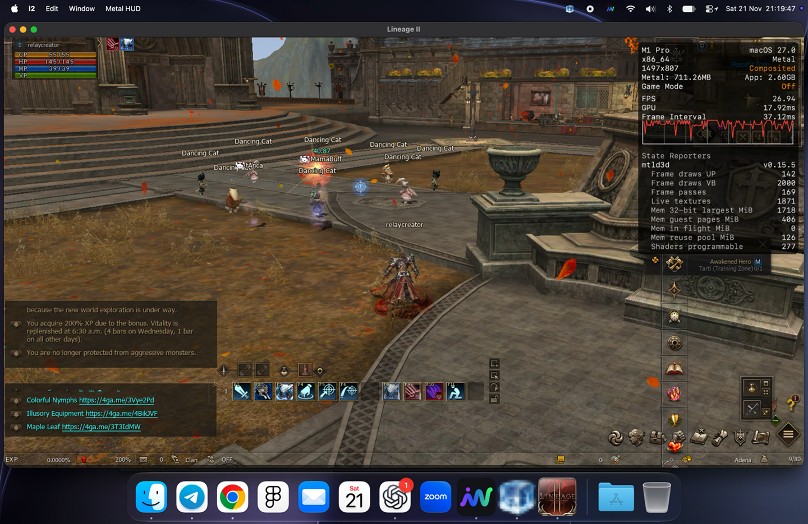
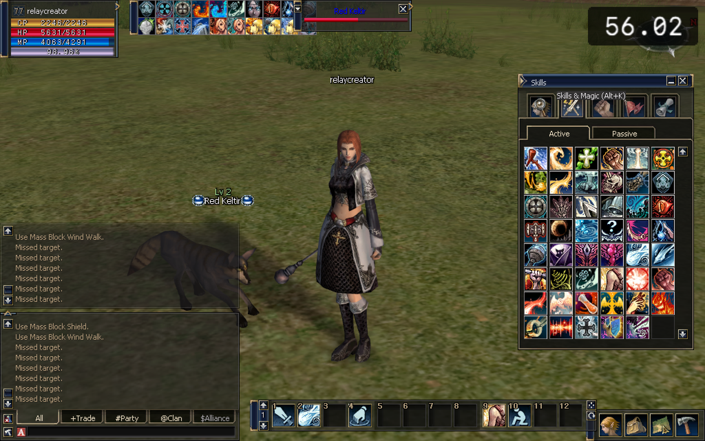
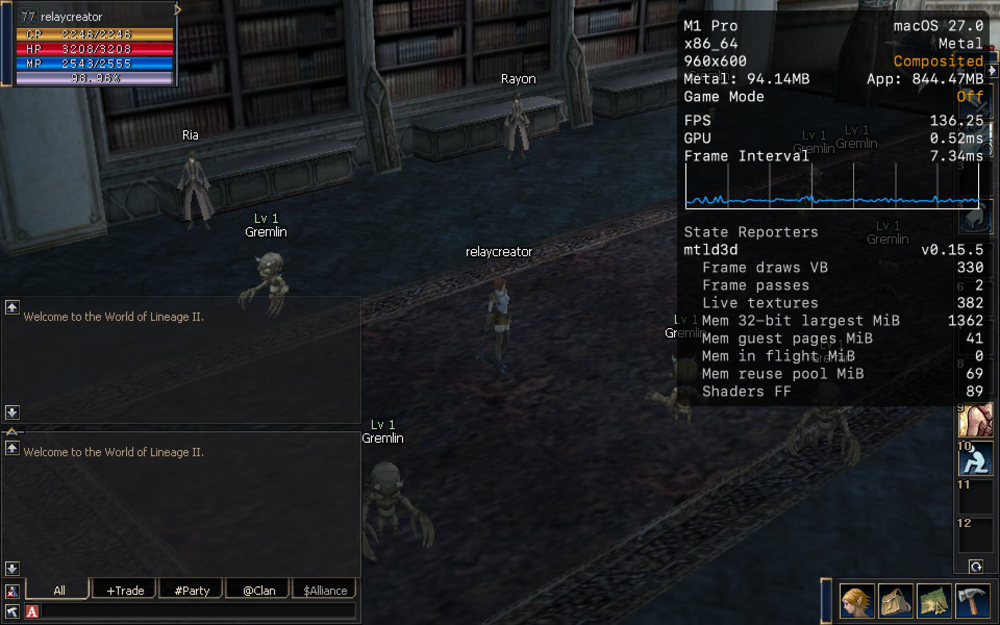
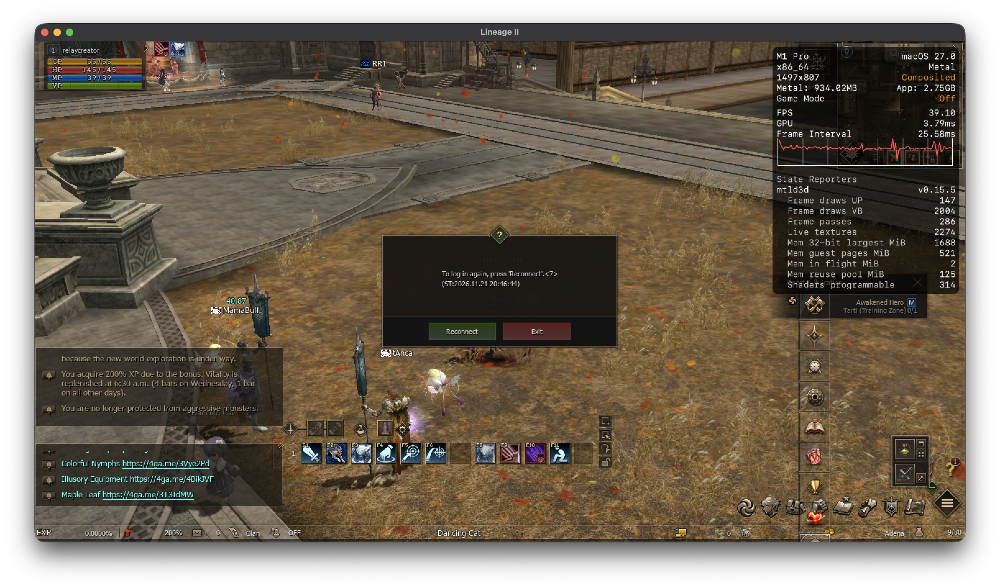

# Sound is back, with playable C4 performance

21 November 2026, Apple M1 Pro / 16 GB / macOS 27.0. Adding **x87sidecar
v1.9.1** to the Highball/Wine + mtld3d/Metal test environment produced a major
local improvement. The maintainer confirmed **audible game sound and responsive
play in both the official 4game client and a separately downloaded C4 client**.
The earlier audio-output-disable workaround was no longer needed for these runs.

The official client still shows **Reconnect after roughly 1–2 minutes** in the
latest sound-enabled trial. This milestone restores usable sound in the observed
sessions; it does not resolve connection stability or establish a universal fix.

## Watch: two short gameplay excerpts

[](official-gameplay-10s.mp4)

[Official 4game client — 10 seconds, MP4](official-gameplay-10s.mp4).
Preserved frame at source second 10; HUD reads 26.94 FPS. Movement and camera
changes are visible in the clip. It comes from the audio-enabled test session.

[](c4-gameplay-10s.mp4)

[Separate C4 client — 10 seconds, MP4](c4-gameplay-10s.mp4).
The screenshot and clip show the later higher-detail scene and interactive skills.
The C4 recording predates the subsequent audio-enabled confirmation.

Both excerpts are normal-speed 720p/30 FPS viewing exports of source seconds 5–15.
**The source screen recordings contain no audio tracks.** These clips demonstrate
visual responsiveness, not audible playback; sound restoration is the maintainer's
direct observation, supported by runtime/audio-device checks. No replacement audio
was added. Recorded/export FPS is not game FPS. [Export metadata and hashes](media.json).
Original recordings and screenshots remain preserved locally.

## Results and their evidence

| Scenario | Result | Evidence type |
| --- | --- | --- |
| C4 login screen | About **66 FPS**, versus earlier samples near **10 FPS** | Maintainer HUD observation; earlier recorded trials. The nominal ~6.5× difference is not a controlled speedup measurement. |
| C4 world, reduced detail, 960×600 | HUD snapshot **136.25 FPS** | Original screenshot below; an instantaneous reading, not a session average. |
| C4 world, increased graphics and view distance | Maintainer reported roughly **30–50 FPS** and playable movement; later screenshot reads **56.02** | User observation and separate preserved image. Saved viewport was 1024×640. |
| C4 with audio re-enabled | Sound works, movable native frame works, smoothness retained | Maintainer confirmation; loaded audio modules and one active playback endpoint. No exact audio-enabled FPS trace or session duration. |
| Official 4game client with audio re-enabled | Audible sound and responsive world interaction returned | Maintainer confirmation, cooperative game hook, Metal/audio-module logs and device checks. |
| Official connection stability | Reconnect returned after about **1–2 minutes** with audio enabled | Maintainer estimate; cause unresolved in [#9](https://github.com/deusmarsh/unnoficial-relay-l2/issues/9). |



*Original 21 November screenshot, 960×600 game viewport. This is a selected HUD
snapshot in a different scene from the older C4 baseline, not a matched benchmark.*



*Earlier 21 November x87/Metal session with audio output disabled, HUD 39.10 FPS.
Retained as direct evidence that Reconnect persisted before audio was re-enabled;
it is not a screenshot of the later sound-enabled disconnect.*

The old C4 runs, new C4 runs and official-client runs differ in scene/settings,
server and sometimes renderer revision. Do not turn those observations into a
claim that all Lineage II clients became 6.5× faster. A matched sidecar-off control
and frame-time capture remain useful follow-up work. The separate C4 client was
downloaded independently and tested locally; it is not the official 4game build.

## Try x87sidecar and audio in an existing Metal source setup

This opt-in extends the existing PR #11 source setup. Complete `./dev setup`
first, then close that installation's launcher and game:

```sh
python3 x87_audio.py
./dev run
```

The command downloads the pinned official `x87sidecar.tar.xz`, checks the archive
and executable SHA-256, probes the installed Rosetta and requires the existing
Wine cooperative hook. A real 32-bit test then verifies cooperative attachment,
x87 arithmetic, a mtld3d D3D9 device/presentation and at least one active playback
endpoint before writing the local configuration. The previous configuration is
backed up under `.build/x87-audio-backups/`.

It sets `ROSETTA_X87_PATH` to that verified executable and stops adding
`winecoreaudio.drv=d`. It does not replace OpenAL libraries, alter the game's
executables, change system audio settings or patch the publisher's security code.
Ordinary runs discard inherited `X87_*` experimentation flags. No elevated
debugger attachment is needed: the pinned Wine cooperates with the sidecar.

To return to the previous configuration, close the launcher/game, then:

```sh
python3 x87_audio.py --disable
./dev run
```

New setup and existing configurations retain their previous behavior until this
explicit opt-in. This command is for the Metal **source** installation, not the
legacy standalone/DMG builder or a C4 game downloader. No C4 files are distributed.

## Validation and provenance

- Portable source suite: **64 tests, 61 passed, 3 environment-specific skips**.
- Final helper enabled x87/audio on an isolated clone of the source-created
  PR #11 runtime/prefix: Rosetta supported, cooperative hook active, 32-bit Metal
  presentation successful, one playback endpoint, numeric x87 check passed.
- Disable restored the audio-disabled configuration. The old default remains.
- Actual manual game sessions confirmed world entry and audible sound separately
  in the official client and C4. Fresh publisher installation/gameplay through
  this new helper on another Mac remains unverified.
- Recorded gameplay used a locally patched mtld3d 0.15.5 material fix, UUID
  `CB416DC4-91B5-357E-9479-64FB1D26DA9F`. The activation-helper hardware check
  used the source installer's stock pinned renderer. **This opt-in does not
  install the separate material fix** and does not close texture issue #2.

[Sanitized check summary](validation.json). No account data, private filesystem
paths, raw runtime logs, game files or downloaded binaries are published.

Earlier synthetic x87 tests in the manual environment showed about 1.93× shorter
addition-loop time and 54.04× shorter `fsin`-loop time across two runs per mode.
Those are short instruction microtests, not game-FPS gains or full numerical
equivalence checks. They are distinct from the observed C4 improvement.

Upstream: [x87sidecar](https://github.com/athei/x87sidecar),
[pinned v1.9.1 release](https://github.com/athei/x87sidecar/releases/tag/v1.9.1).
The maintainer accepted this practical audio/performance result and requested
closure of [#4](https://github.com/deusmarsh/unnoficial-relay-l2/issues/4).
This records resolution of the observed blocker on the tested Mac, not completion
of a controlled pause benchmark or a universal performance guarantee.
Reconnect [#9](https://github.com/deusmarsh/unnoficial-relay-l2/issues/9) remains open.
